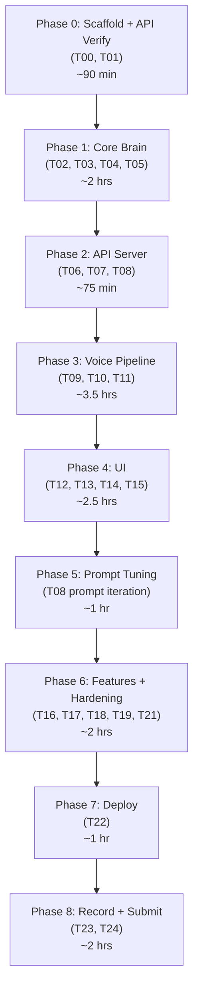

# Snapdeal Voice KAM "Asha" — Execution Plan

> **Current time:** 10 Nov 2026, 17:50 IST  
> **Hard deadline:** 11 Nov 2026, 11:15 AM IST (~17.5 hours left)  
> **Internal target:** Submit by 08:30 AM IST (~14.5 hours left)  
> **Status read:** ALL tasks T00–T24 are `todo`. Repo exists but is not yet scaffolded.

---

## Critical Review Before Starting

**What looks right in the plan:**
- Architecture (Gemini Live primary, Web Speech fallback) is well-grounded.
- Mock data is fully reconciled and already in `seller.mock.json` ✓
- T00–T24 backlog is complete with copy-paste prompts ✓

**What is risky / needs immediate attention:**
1. `gemini-3.8-live` model ID — must verify before ANY code is written (Task T01 is life-or-death for 30/100 marks).
2. We need a **Gemini API key** before T01. No key = fallback-only mode (which still passes, but loses Live voice score).
3. Time budget: 17.5h for T00–T24 is tight. The plan's recommended order (T00→T05 first, voice pipeline T09–T11, then UI) is correct. **Never start UI before voice works.**
4. `pnpm handoff` script needs `docs/` folder structure created in T00.

---

## Phase Map (what we'll build, in what order)

> [!CAUTION]
> Never start Phase 4 (UI) before Phase 3 (Voice) works end-to-end. Voice is 30/100 marks.

---

## Detailed Task Sequence

### 🔴 Phase 0 — Scaffold + Verify (~90 min | Now → ~19:30 IST)

| Task | What to do | Done when |
|---|---|---|
| **T00** | Create the `snapdeal-voice-kam/` monorepo: `pnpm-workspace.yaml`, root `package.json`, `packages/core/`, `apps/api/`, `apps/web/`. Copy `seller.mock.json` → `packages/core/src/data/`. Copy `scenarios.json` → `evals/`. Create all `docs/` files (CONTEXT, HANDOFF, TASKS, SESSION_LOG, DECISIONS, REVIEW_CHECKLIST). Create `.env.example`. Copy `handoff.sh`. Add `pnpm handoff` script. Init git + first commit. | `git status` clean; `ls docs/` shows all 7 files |
| **T01** | Get Gemini API key (AI Studio). Install `@google/genai`. Run the official `gemini-live-ephemeral-tokens-websocket` example (or a minimal Node script). Confirm: model ID, voice names, tool calling, transcription, ephemeral token format. Write confirmed values into `docs/CONTEXT.md`. | You hear the model speak audio from a Node script |

> [!IMPORTANT]
> If T01 fails (quota/key/model issue) → switch to **fallback-primary** mode immediately (Web Speech STT → Gemini text → speechSynthesis). Never block on this.

---

### 🟠 Phase 1 — Core Brain (~2 hrs | ~19:30–21:30 IST)

| Task | What to do | Done when |
|---|---|---|
| **T02** | `packages/core/src/types.ts` — Zod schemas for `Seller`, `Metrics`, `Diagnosis`, `ActionPlan`. `provider.ts` — `DataProvider` interface + `MockSellerProvider` that loads `seller.mock.json`. | Types compile; provider returns loaded seller |
| **T03** | `analytics.ts` — `snapshot()`, `bridge()`, `ruledOut()`. Vitest tests: Σorders=400/270, Σ₹=200k/135k, cancels=32/38, OOS=5/18, bridge=23085+18570+23345=65000, pricing ruled out. | `pnpm --filter @kam/core test` → all green |
| **T04** | `recommend.ts` — generate exactly 3 prioritised actions with ₹ impact (from bridge), owner, timeline, cash-flow awareness (top-4 OOS first if cash tight). Tests: always returns exactly 3 actions; impact ≈ ₹18k/₹23k/₹18.5k. | Tests green; action objects have all required fields |
| **T05** | `tools.ts` — JSON schema declarations + handler implementations for all 8 tools: `get_seller_snapshot`, `analyze_sales_decline`, `get_out_of_stock_products`, `get_cancellation_breakdown`, `advance_stage`, `create_action_plan`, `schedule_followup`, `escalate_to_human_kam`. All Zod-validated, 2s timeout, return `{ok, data?, error?}`. | Unit tests for each handler pass |

---

### 🟡 Phase 2 — API Server (~75 min | ~21:30–22:45 IST)

| Task | What to do | Done when |
|---|---|---|
| **T06** | Fastify server in `apps/api/src/server.ts`. `/healthz`, CORS (allow-list from env), rate limit `/api/session` (10/min/IP), pino logging, error handling. `POST /api/tools/:name` route that validates tool name, calls the handler, returns JSON. | `curl localhost:8080/healthz` → `{ok:true}`; `curl POST /api/tools/get_seller_snapshot` returns correct data |
| **T07** | `routes/session.ts` — `POST /api/session` mints ephemeral token using `@google/genai`, locked to `GEMINI_LIVE_MODEL` + system prompt + tools. Returns `{token, model}`. | `curl POST /api/session` returns a token string; using it in a WebSocket connect works |
| **T08** | `packages/core/src/prompt.ts` — `buildSystemPrompt(lang)` returns the full system prompt from §10.4. Snapshot test (prompt contains all required sections: ROLE, VOICE STYLE, GROUNDING RULES, CONVERSATION FLOW, BEHAVIOUR RULES, PROACTIVE MODE). | Snapshot test passes; prompt renders for en/hi/hinglish |

---

### 🔵 Phase 3 — Voice Pipeline (~3.5 hrs | ~22:45–02:15 IST)

> [!IMPORTANT]
> Start from the official `gemini-live-ephemeral-tokens-websocket` example. Adapt it — don't rewrite from scratch.

| Task | What to do | Done when |
|---|---|---|
| **T09** | `apps/web/public/audio-worklet.js` — `PCMCapture` processor (downsample mic → 16 kHz PCM16, emit 640-sample frames every ~40 ms). `apps/web/src/audio/capture.ts` — `getUserMedia`, `AudioContext`, loads worklet, fires `onFrame(ArrayBuffer)`. Mic constraints: mono, echoCancellation, noiseSuppression, autoGainControl. | Mic permission prompt works; console shows Int16 frames of correct size |
| **T10** | `apps/web/src/audio/player.ts` — 24 kHz `AudioBufferSource` queue, `nextStartTime` scheduling, gapless playback, instant `flush()` (stops all active sources). `toBase64()` / `fromBase64()` helpers. | Synthetic 24 kHz PCM test plays without gaps; `flush()` stops mid-stream |
| **T11** | `apps/web/src/live/LiveSession.ts` — full implementation: connect with ephemeral token, send PCM audio, receive audio chunks (enqueue to player), handle `interrupted` (flush player), transcription events, tool calls (relay to `POST /api/tools/:name`, send toolResponse), `sessionResumptionUpdate` (save handle), `goAway` (pre-emptive reconnect). `toolBridge.ts`. Fallback to Compatibility mode on `onclose`/`onerror` after 2 retries. | A full spoken conversation works: seller speaks → Asha responds via audio; tool call fires and returns numbers |

---

### 🟢 Phase 4 — UI (~2.5 hrs | ~02:15–04:45 IST)

| Task | What to do | Done when |
|---|---|---|
| **T12** | `App.tsx`, `useCallStore.ts` (Zustand), `Orb.tsx` (idle/listening/thinking/speaking states, Framer Motion animation). Start/End Call button. Mode badge (Live/Compatibility). | Orb changes state correctly; Start/End cycle works |
| **T13** | `Cockpit.tsx` (KPI cards with deltas, red/green), `ActivityFeed.tsx` (tool name + ms + ✓), `Transcript.tsx` (seller vs Asha, streaming), `StageTracker.tsx` (Understand → Diagnose → Recommend → Commit). | All 4 components update in real time during a call |
| **T14** | `ActionPlan.tsx` (3 actions, ₹ impact, owner, due date — builds up live), `Summary.tsx` (call summary card), Download .md button, Assumptions drawer. | Action plan fills during the call; summary appears after call ends |
| **T15** | Language toggle (EN / HI / Hinglish), `LanguageToggle.tsx`. Pass `lang` to `/api/session`. Proactive mode button ("▶ Simulate: Asha calls you"). Mock data banner ("AI demo — mock data only"). | Toggle changes language in next session; proactive button triggers proactive system prompt |

---

### 💜 Phase 5 — Prompt Tuning (~1 hr | ~04:45–05:45 IST)

Run ≥5 scripted conversations (T01, T04, T07, T10, T12 scenarios from `scenarios.json`). Check:
- Turns ≤ 25 words
- Filler before every tool call
- Exactly 3 recommendations
- Corrects false price belief
- Language mirrors seller

Tune `prompt.ts`, re-run `pnpm evals`, note results in SESSION_LOG.

---

### ⚫ Phase 6 — Features + Hardening (~2 hrs | ~05:45–07:45 IST)

| Task | What to do |
|---|---|
| **T16** | Fallback (Compatibility) mode: `speechLoop.ts` — `SpeechRecognition` → `POST /api/chat` → `speechSynthesis`. `/api/chat` route with Gemini text model + same tools. Auto-trigger on Live failure. |
| **T17** | Proactive mode: `portfolio` data → highest `anomalyScore` seller (SD-48213) → trigger system prompt with `PROACTIVE_TRIGGER`. |
| **T18** | Escalation flow: when `escalate_to_human_kam` called → show banner "Escalated to human KAM" in UI. |
| **T19** | Eval harness: `evals/run-evals.ts` text-injection for top 10 scenarios; LLM judge scores pass/fail. |
| **T21** | Hardening: CSP headers, CORS, rate limit tuned, tool input sanitization, structured error responses, `/metrics` JSON endpoint. |

---

### 🚀 Phase 7 — Deploy (~1 hr | ~07:00–08:00 IST)

| Step | Action |
|---|---|
| **Web** | `pnpm --filter web build` → deploy to Vercel (`vercel --prod`) or Cloudflare Pages |
| **API** | Dockerfile for `apps/api` → deploy to Railway or Render (free tier), set all env vars |
| **Verify** | Test from phone on a different network. HTTPS required for mic. 3 consecutive full conversations. `?mode=fallback` forces fallback. |

---

### 📹 Phase 8 — Record + Submit (~2 hrs | ~08:00–10:30 IST)

| Step | Action |
|---|---|
| **T23** | Rehearse once, record 2–3 takes with OBS (Desktop Audio + Mic), use the demo script from §13. Keep best take ≤2 min. Export MP4. |
| **T24** | Write README (3-command run, env vars, architecture, assumptions). Fill in `<URL>`, `<GitHub>`, `<recording link>` in the one-page note template (§14). Send email to Sourav (§15 template). |

---

## ⚡ Cut Order (if behind schedule)

**Never cut:** Live voice, all 8 tools, 3 recommendations, summary, fallback, README, note, recording.

**Cut in this order:**
1. T20 Playwright E2E (manual smoke test is enough)
2. T19 Eval harness (run a few manually)
3. T18 Escalation UI (tool still works; just no banner)
4. T15 Hindi toggle polish (English + Hinglish is enough)
5. T17 Proactive mode demo (can demo reactively instead)

---

## 📋 Context Protocol Reminder

After **every task** you must:
1. Update `docs/CONTEXT.md` (rewrite status table, set NEXT STEP)
2. Append to `docs/SESSION_LOG.md`
3. Update `docs/TASKS.md` status + evidence
4. Add ADRs to `docs/DECISIONS.md` for non-trivial choices
5. Run `pnpm handoff` → write `docs/HANDOFF.md`
6. `git add -A && git commit -m "T<id>: 
"`

> [!NOTE]
> This protocol ensures you can switch from Antigravity to any other tool (Claude Code, Cursor, etc.) at any time with zero context loss. The context files ARE the shared memory.

---

## ❓ Blockers / Questions Before Starting

1. **Do you have a Gemini API key?** (Get one free at ai.google.dev/aistudio) — needed for T01 and T07.
2. **Git initialized?** The repo at `c:\Users\VICTUS\Downloads\VAM` has loose files but no monorepo structure yet. T00 will create the full structure.
3. **Node 20+ and pnpm installed?** Needed for T00.

---

## My Approach

I will build this **one task at a time**, in the order above. After each task:
- Show you the test output (evidence)
- Do the self-review (3 failure modes, security, regressions)
- Update all context files and commit
- Tell you clearly: what's done, what's risky, exact next step

**Ready to start with T00 — scaffold the monorepo?** Just say "go" or tell me if you need to adjust anything first (especially: do you have the Gemini API key ready?).
